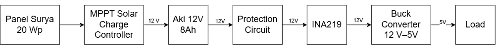
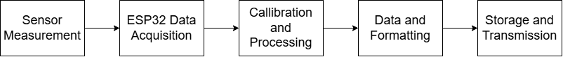
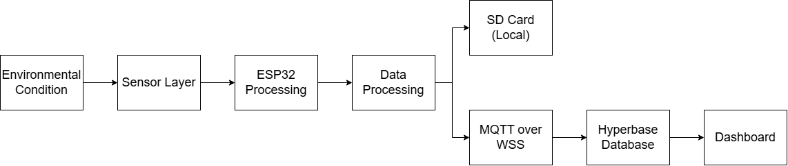

# 2 System Architecture

## 2.1 Overall architecture

The baseline combines power distribution, sensing, timed aggregation, local persistence, and wireless delivery. The overall architecture diagram below was updated by the owner on 20 November 2026. It shows the power source, controller, sensors, storage, modem, and monitoring platform; the following sections describe the operating baseline and wiring references.

Figure 2.1 Overall system architecture of the ESP32-based Miniweather Station, updated 20 November 2026.

## 2.2 Power layer

The operating supply is a solar/battery system. Owner-confirmed values are a 12 V 8 Ah battery, SCC maximum rating of 10 A, reported discharge setting of 10.7 V, and MP1584 nominal 5 V / 3 A converters. The panel rating and exact SCC model/type require label verification.

The CAD reference separates the controller/sensor branch from the modem branch. The modem branch uses a TS/MOSFET module controlled by GPIO32. Both buck inputs originate on the load side of the INA219 shunt in the CAD reference; final wiring must be checked before claiming complete load coverage.

  

Figure 2.2 Power flow of the ESP32-based Miniweather Station.

Use the written configuration for current ratings. The retained power illustration contains earlier component descriptions. INA219 is downstream of protection components, so its reported voltage is not automatically the voltage directly at the battery terminals.

## 2.3 Sensor layer

| Interface | Devices or functions |
|---|---|
| Main I2C bus, SDA21/SCL22 | SCD40, BMP280, BH1750, AS5600, INA219 |
| Pulse GPIO | Anemometer GPIO14 and tipping bucket GPIO13 |
| Trigger/echo GPIO | JSN-SR04T, TRIG4 and ECHO5 |
| SPI | microSD with CS15; standard board wiring uses MOSI23, MISO19, SCK18 |
| Reserved UART header | GPIO16/17; no UART sensor installed |

The level-buffer design routes JSN ECHO through U1 before GPIO5. Connector numbering and supply order must be checked against the CAD and the physical harness.

## 2.4 Processing layer

Figure 2.3 Processing sequence of the ESP32-based Miniweather Station.

The main loop services measurements, network state, delivery queues, and modem recovery. A one-second target sampler updates held sensor values. A time-weighted integrator splits elapsed time at 60-second boundaries, then produces a reporting record.

Wind direction integrates sine/cosine components. Rainfall uses pulse accumulation. Energy integrates INA219 mW readings. Rounding follows aggregation. Invalid data may be represented by JSON null or CSV nan.

TLS, MQTT, and SD operations can still block the main loop. Integration holds the last reading across a delay; this is not a hard real-time guarantee of 60 fresh samples.

## 2.5 Local persistence

Minute CSV logging and the delivery queue serve different purposes. `data_minute.csv` is the measurement archive; `live_outbox.json` holds one unfinished live record; `pending.txt` and `pending_ack.log` provide backlog storage and checkpointing.

A backlog position advances after a broker PUBACK and successful checkpoint storage. Power interruption can cause re-delivery, so database deduplication requires use of `message_id`. RAM fallback is bounded and is not power-loss persistent.

## 2.6 Communication and supervision

The ESP32 selects among registered WiFi networks/APs, connects to the MQTT service through WSS, and publishes with QoS 1. A recent live PUBACK is distinct from CONNECT/CONNACK and from a database-write acknowledgement.

The probe worker tests two TCP destinations for modem recovery evidence. The LED worker expires the main-loop snapshot if it becomes stale. Neither task establishes that the dashboard or every sensor is healthy.

## 2.7 Data flow

  
  

Figure 2.4 Data flow of the ESP32-based Miniweather Station.

The current logical flow is sampling, aggregation, validation/rounding, CSV and live staging, live attempt, then at most one paired backlog attempt after a live ACK. Failure retains or queues the record within storage limits. Original timestamps are retained when present.

## 2.8 Baseline boundaries

The current firmware does not implement production OTA or the NVS provisioning commands from the separate RSSI test. Published drawings and manufacturing files require revision reconciliation with the owner-supplied PCB layer package; see [Hardware handover](../Hardware/handover.md).
