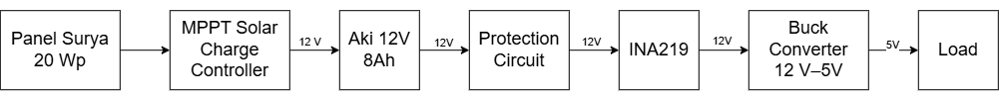

# 3 Hardware Design

## Hardware reference

The owner identifies the 20 October PCB PDF layer package as the current layout reference. Its visible BC1/BC2, TS, USB, U1, and C16 features align with the local Rev D CAD reference. Visual agreement is not verification that every net, drill, and public Gerber export is identical.

The detailed [hardware handover](../Hardware/handover.md) distinguishes owner-confirmed specifications, CAD connectivity, and physical tests still to be recorded.

## Hardware architecture

The following diagram is the owner's update uploaded on 20 November 2026. It summarizes the power, control, sensing, and storage blocks. Use the connector and voltage-level references below for wiring: JSN-SR04T uses the 5 V branch with buffered ECHO, and the CAD microSD header supplies 3V3. Supply labels in a block diagram do not replace the module-specific wiring reference.

Figure 3.1 Hardware architecture of the ESP32-based Miniweather Station, updated 20 November 2026.

## Controller and sensors

The baseline uses an ESP32 DevKit with 4 MB flash reported by the owner. SCD40, BMP280, BH1750, AS5600, and INA219 share the main I2C interface. The anemometer is pulse-based, and the tipping bucket produces rainfall pulses. JSN-SR04T provides trigger/echo distance measurements for local water-level estimation.

| Function | Firmware GPIO or connection |
|---|---|
| I2C SDA / SCL | 21 / 22 at 100 kHz |
| Anemometer pulse | 14, INPUT_PULLUP, FALLING interrupt |
| Rain pulse | 13, INPUT_PULLUP, FALLING interrupt |
| Ultrasonic TRIG / ECHO | 4 / 5; ECHO through the buffer in the CAD reference |
| microSD | CS15; CAD nets MOSI23, MISO19, SCK18 |
| RGB LED | R25, G26, B27; code uses common-anode false |
| Modem power control | 32 through R4 to TS; HIGH-on confirmed by the owner |
| Reserved UART | TX16 / RX17; no UART sensor installed |

## Connectors and voltage levels

The CAD reference has two I2C header arrangements. I2C1–I2C6 use pad order 1 SDA, 2 SCL, 3 GND, 4 3V3. U7–U9 use 1 3V3, 2 GND, 3 SCL, 4 SDA, plus a fifth pad not used by the firmware. They are not pin-compatible harness arrangements.

These are CAD pad numbers, not an assumed left-to-right cable view. Identify pad 1 and verify continuity before assembly. Supply voltage and connector shape alone do not establish that a sensor output is safe for an ESP32 input.

U1 is specified as SN74LVC2G17DBVR with 3V3 supply and C16 100 nF. The CAD routes JSN_ECHO_5V through channel 1 to IO5, and the reserved WIND_TX_5V through channel 2 to IO17. Check the physical orientation and fitted component.

## Local storage

The microSD interface supports measurement CSV, persistent outbox/journal, and event logs. Its CAD header supplies 3V3; confirm that the selected SD module and pin order match this supply.

## Communication hardware

Figure 3.2 Communication process of the ESP32-based Miniweather Station.

The USB 4G modem provides WiFi access; the ESP32 does not use modem USB data in this firmware. The CAD includes a separate modem buck branch and TS-controlled USB power. USB return is a separate output net in the CAD, so an external ground connection must not be assumed harmless to the switching function.

## PCB revision and component verification

The local revision history records U1/C16 additions, routing refinements, 0.6 mm GND pour clearance, and Rev D via changes to 1.0 mm diameter / 0.6 mm drill. A recorded zero-DRC result applies to that CAD review; it does not certify fabricated-board operation, RF, thermal behavior, or the files currently published in `Hardware`.

Resistor labels and stored supplier/MPN metadata require reconciliation before ordering parts. Verify footprint, fitted value, capacitor voltage rating/polarity, and harness orientation against the physical unit.

## Mechanical installation

Existing project records describe PETG enclosures, a radiation shield, sensor mounting, and rooftop installation. Inspect sealing, drainage, strain relief, antenna clearance, and mounting strength on the actual unit. Record vane north alignment and ultrasonic installation reference.

## Power architecture

Figure 3.3 Power flow of the ESP32-based Miniweather Station.

Current owner-confirmed specifications are 12 V 8 Ah battery, SCC maximum 10 A with reported discharge setting 10.7 V, and MP1584 nominal 5 V / 3 A. The retained figure is awaiting a separate graphics update. Converter rating and CAD layout do not replace loaded voltage, current, temperature, and transient measurements.

## Further work

Reconcile as-built BOM, PCB manufacturing files, harness records, and acceptance-test evidence. Production OTA and further power optimization remain [future development](10.%20Future%20Development.md).
