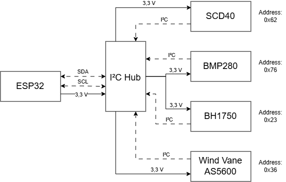
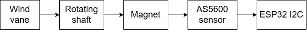
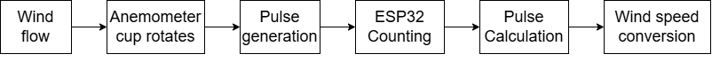
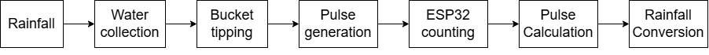
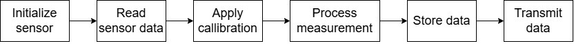

# 4 Sensor Configuration

## Sensor architecture

The sensor overview below was updated by the owner on 20 November 2026. It shows the I2C devices, pulse inputs, ultrasonic trigger/echo interface, and local storage. INA219 electrical monitoring is described separately in this chapter and in the system architecture. For supply and level conversion, use the [hardware wiring reference](03.%20Hardware%20Design.md#connectors-and-voltage-levels).

<div align="center">


</div>

<p align="center">Figure 4.1 Sensor architecture of the ESP32-based Miniweather Station, updated 20 November 2026.</p>

| Device | Output | Unit |
|---|---|---|
| SCD40 | Temperature, humidity, CO2 | degC, %RH, ppm |
| BMP280 | Pressure and derived altitude | hPa, m |
| BH1750 | Illuminance | lux |
| AS5600 | Vane angle | degrees |
| Pulse anemometer | Wind speed | m/s |
| Tipping bucket | Accumulated rainfall | mm |
| JSN-SR04T | Local water level derived from distance | cm |
| INA219 | Voltage, current, integrated energy | V, mA, mWh |

## Interfaces and sampling

<div align="center">



</div>

<p align="center">Figure 4.2 I2C bus diagram of the ESP32-based Miniweather Station.<p>

The main bus uses SDA21/SCL22 at 100 kHz. Configured or default addresses are BMP280 0x76, AS5600 0x36, SCD40 0x62, BH1750 0x23, and INA219 0x40. Verify address jumpers and module variants rather than assuming every module uses its default address.

The target sampler interval is one second; the reporting window is 60 seconds. SCD40 produces new values according to its data-ready state, approximately every five seconds in the documented mode. The last valid SCD40 value is held between updates and invalidated after 15 seconds without valid data.

Most outputs use a time-weighted mean of valid held values. Delayed network/SD operations can extend the hold interval. Invalid measurements are not intentionally replaced with a fabricated zero.

## SCD40 and BMP280

SCD40 provides temperature, humidity, and CO2. The firmware applies the inverse calibration functions and clamps humidity to 0–100%.

BMP280 pressure is converted from Pa to hPa. `readAltitude(1013.25)` uses a fixed sea-level reference in hPa, followed by the altitude correction. This is pressure-derived altitude, not a separate GNSS measurement.

## BH1750

BH1750 is initialized in continuous high-resolution mode. Its corrected result is illuminance in lux. The current firmware does not convert lux to calibrated solar irradiance or panel power.

## AS5600 wind direction

<div align="center">



</div>

<p align="center">Figure 4.3 Wind direction measurement of the ESP32-based Miniweather Station.<p>

The AS5600 is read directly through `Wire`; an additional AS5600 library is not used. Raw angle becomes `raw * 360 / 4096`, then the installation offset and `cal_VANE` correction are applied and wrapped.

The reporting angle is a time-weighted circular mean using sine/cosine components. Thus 359 degrees and 1 degree average near 0 degrees, not 180 degrees. Opposing components that cancel can produce an undefined/null result. The mean is not weighted by wind speed.

The output convention is 0 north, 90 east, 180 south, and 270 west after installation alignment. Record the actual north reference and mechanical offset.

## Anemometer

<div align="center">



</div>

<p align="center">Figure 4.4 Wind speed measurement of the ESP32-based Miniweather Station.<p>

The owner confirms pulse output on GPIO14. The reserved UART header has no sensor installed.

The implementation counts pulses over actual elapsed time and computes:

```text
f = pulse_count / elapsed_seconds
speed_raw = -0.0181*f*f + 1.3859*f + 1.4055
if speed_raw < 1.5: speed_raw = 0
speed_corrected = max(0, (speed_raw - 0.1804) / 0.8858)
```

Do not infer pulses per mechanical revolution from the variable name `rps` without the sensor specification. Corrected speed is then time-averaged over the reporting window.

## Tipping bucket

<div align="center">



</div>

<p align="center">Figure 4.4 Rainfall measurement of the ESP32-based Miniweather Station.<p>

GPIO13 counts FALLING edges with a nominal 3 ms debounce. The configured base coefficient is `MM_PER_TICK = 0.2` mm. This is a firmware coefficient that should be checked against the physical gauge calibration.

Raw total is tick count since boot multiplied by 0.2. For positive totals, the corrected total is `(raw_total + 0.2808) / 1.1678`; zero remains zero. Rainfall per reporting window is the difference between successive corrected totals.

The first tick after startup contributes approximately 0.4117 mm before output rounding; each later tick adds approximately 0.1713 mm before rounding. The intercept is applied to the total, not anew every minute. The total resets at startup and is not a persisted daily total.

`curah_hujan` is interval accumulation. CSV also records `rain_rate_mmh`, `rain_interval_mm`, and `total_rain_mm`; these extra three fields are not part of the MQTT `data` object.

## Ultrasonic water level

JSN-SR04T uses TRIG4 and ECHO5, with ECHO level buffering in the CAD reference. The firmware estimates distance from pulse duration and computes `level_cm = (88.00 - distance_cm) / 1.0257`, clamped to 0–85 cm.

The 88 cm zero reference and 85 cm software limit must be checked against installation geometry and the actual module's valid range/blind zone. `ketinggian_air_laut` is a legacy key for this local water level; it does not represent geographic sea-level elevation.

## INA219

`voltage` averages bus voltage plus shunt voltage in V. `current` averages `getCurrent_mA()`. `power` integrates `getPower_mW()` over the reporting window and is transmitted in mWh. Full valid time coverage is required for the energy output; otherwise it is null.

## Processing and calibration

<div align="center">



</div>

<p align="center">Figure 4.5 Sensor data flow of the ESP32-based Miniweather Station.<p>

Rounding follows aggregation. See [calibration parameters](../Firmware/calibration.md) for inverse-regression equations and [firmware design](05.%20Firmware%20Design.md) for validity, timing, and payload behavior.
