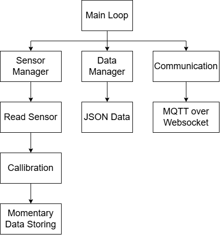
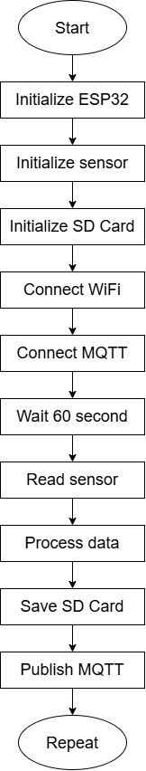
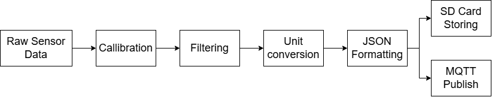

# 5 Firmware Design

## Baseline and structure

The 10 November 2026 baseline is implemented in one `.ino` file. It combines sensor sampling, 60-second aggregation, local storage, WiFi/MQTT service, delivery pacing, modem recovery, and status supervision.

Figure 5.1 Firmware architecture of the ESP32-based Miniweather Station.

## Startup and loop

Figure 5.2 Firmware flowchart of the ESP32-based Miniweather Station.

The retained flowchart describes an earlier sequence and will be revised separately. The current program does not simply wait 60 seconds before reading every sensor.

Startup enables modem power, initializes GPIO/I2C/sensors/SD, configures NTP with a fixed UTC+7 local-time offset, creates runtime client/boot IDs, starts recovery supervision, and initializes the measurement window and LED task. Missing SD or a sensor does not intentionally halt all operation.

The modem policy initially allows 120 seconds for boot before starting the network scan. Measurement processing continues during this period.

The main loop repeatedly services measurements, recovery, LED snapshots, networking, and outbox/backlog delivery. A TCP probe worker and a delivery-LED worker run separately; the main loop owns GPIO switching, SD operations, and the main WiFi/MQTT state changes.

## Sampling and aggregation

`SAMPLE_INTERVAL_MS` is 1000 and `MEASUREMENT_INTERVAL_MS` is 60000. The `TimedMean` accumulator integrates each valid held value over elapsed milliseconds. At each window boundary it produces a valid-time-weighted mean and resets the area while retaining the held reading.

Direction integrates sine/cosine; rainfall uses interval accumulation; energy uses the power integral. No rounding is applied before aggregation. JSON represents unavailable numeric values as null and CSV writes nan.

Figure 5.3 Data processing flow of the ESP32-based Miniweather Station.

WSS/TLS/MQTT and SD calls remain synchronous in places. A delay causes held-value integration and a `SAMPLE LAG` diagnostic. This is not a hard real-time guarantee of one fresh sample per second during every failure mode.

## Storage and recovery

| File | Purpose |
|---|---|
| `/data_minute.csv` | Minute measurement archive |
| `/live_outbox.json` | One unfinished persistent live record |
| `/pending.txt` | Append-only backlog journal |
| `/pending_ack.log` | Offset checkpoints with CRC |
| `/pending.off` | Legacy offset read during migration when applicable |
| `/delivery_events.csv` | Delivery attempts/results and message IDs |
| `/modem_events.csv` | Modem recovery events and cycle budget |

The journal position advances after PUBACK and verified checkpoint storage. Startup may recover unfinished outbox data into backlog. Re-delivery can occur after interruption; the mechanism does not promise exactly-once database insertion.

SD remount is retried nominally every 30 seconds on storage faults. The RAM backlog fallback holds eight messages and is not persistent across power loss. Journal/checkpoint files grow and require controlled maintenance; they are not automatically compacted after draining.

Event CSV files are not a full recording of every Serial line. Some diagnostics remain Serial-only.

## Delivery state

A new minute record becomes live if it is still within its allowed age. Live is tried first; failure/offline state sends it to backlog. One successful live PUBACK grants one backlog attempt. That permission is consumed even when the backlog attempt fails; reconnect does not create extra permissions.

Messages contain a boot/sequence-based `message_id`. Backlog retains the ID and original measurement timestamp when available, and may add `delivery_type` and a paired-live ID within the payload limit.

## LED supervision

The LED task checks snapshots about every 200 ms. A main-loop snapshot older than 10 seconds forces red. Green also requires a current healthy transport/session, confirmation of the latest live record, live ACK age at most 90 seconds, and no checked fault flags. A backlog ACK by itself does not establish green.

Blue blinking indicates network/recovery phases. Red indicates unmet delivery/health conditions or an expired main-loop snapshot. Green does not certify database persistence or complete sensor health.

## Modem recovery

Recovery targets the configured modem SSID. Fresh ACK/probe evidence, repeated failures, and alternate-AP state determine whether a continuous fault timer may run. The baseline uses 4 minutes of confirmed failure, 30 seconds OFF, 120 seconds boot wait, a 10-minute minimum cycle gap, and at most four cycles per rolling hour.

The RTC cycle budget is conservative across warm restarts; it is not a permanent power-loss record. See [Communication System](06.%20Communication%20System.md).

## Payload and development status

The payload schema and units are defined in the [communication document](06.%20Communication%20System.md#data-payload-structure). The production source does not implement OTA or the `SET_WIFI` NVS provisioning commands from the separate test sketch. Those features remain [future work](10.%20Future%20Development.md).
