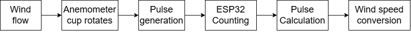
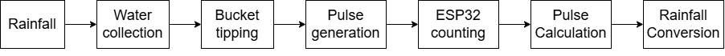

# 6 Communication System

## Communication architecture

The ESP32 publishes measurements to the broker through WiFi and MQTT over WSS. Hyperbase/database processing follows broker delivery and must be verified independently.

<div align="center">


</div>

<p align="center">Figure 6.1 Communication architecture of the ESP32-based Miniweather Station.<p>

## WiFi selection and failover

`WIFI_LIST` contains two profiles in the supplied baseline. Scanning selects a registered SSID/BSSID using signal strength. Auto-reconnect is managed by the firmware state machine rather than the default WiFi reconnect behavior.

Failed APs may be skipped temporarily for 60 seconds. Ordinary roaming checks are nominally every 120 seconds, use an 8 dB hysteresis, and may be skipped when the existing signal is at least -55 dBm. When broker health remains unconfirmed for 120 seconds, an alternative AP may be sought without requiring a stronger RSSI.

WiFi association alone does not prove internet access or MQTT delivery. The modem SSID in `MODEM_WIFI_SSID` must match the intended modem profile exactly.

## WSS and MQTT

The baseline uses WSS port 443, a configured path/topic, a runtime client ID suffixed with chip identity, a 20-second MQTT keepalive, and WebSocket heartbeat supervision. Publish timeout is configured to 1500 ms; some transport operations remain synchronous.

Publications use QoS 1 and retained false. The publish function considers broker PUBACK, not merely local packet submission. CONNECT/CONNACK establishes a session but does not establish that a measurement has been delivered.

<div align="center">


</div>

<p align="center">Figure 6.2 MQTT data flow of the ESP32-based Miniweather Station.<p>

The current call to `beginSSL` supplies no CA or pin. With the inspected WebSockets library configuration, the no-CA/no-fingerprint path uses insecure certificate verification. WSS transport encryption must not be described as completed server-identity validation. Certificate verification is listed as future work.

## Acquisition and reporting

Digital sensors are sampled on a one-second target service schedule, with SCD40 data readiness respected. Data is aggregated over 60-second windows rather than read only at the final instant.

<div align="center">



</div>

<p align="center">Figure 6.3 Wind speed measurement of the ESP32-based Miniweather Station.<p>

Pulse wind speed is converted/calibrated and time-averaged. Direction uses a circular mean; scalar averaging across 0/360 is not used.

<div align="center">



</div>

<p align="center">Figure 6.3 Rainfall measurement of the ESP32-based Miniweather Station.<p>

Rainfall is accumulated, and electrical energy is integrated. Neither is described as an ordinary arithmetic mean of a per-minute quantity.

## Live and backlog pacing

Each minute record is attempted as live first. A successful live ACK permits one backlog attempt on a following loop iteration. If backlog delivery fails, the record remains and a new permission must come from a later live ACK. Reconnection never drains the queue in one burst.

Thirty existing backlog records require approximately thirty successful live/backlog cycles to drain if no new faults intervene. SD failures, lost acknowledgements, or further outages can extend this time.

`pending.txt` and checkpoint state are persistent when SD is healthy. Eight RAM fallback records are not power-loss persistent. Acknowledgement/checkpoint interruption can cause duplicates; platform deduplication must use `message_id` if exactly-once storage is desired.

## Data payload structure

The following is an illustrative format example, not a field-test result:

```json
{
  "message_id": "example-boot-1",
  "delivery_type": "live",
  "timestamp": 1794877200,
  "data": {
    "arah_angin": 0,
    "kecepatan_angin": 2.1,
    "altitude": 150,
    "curah_hujan": 0,
    "intensitas_cahaya": 850,
    "tekanan_udara": 996,
    "temperature": 28.5,
    "kelembapan": 72,
    "co2": 450,
    "ketinggian_air_laut": 20,
    "voltage": 12.00,
    "current": 175.0,
    "power": 35.0
  },
  "power_unit": "mWh",
  "aggregation_seconds": 60,
  "modem_recovery_count": 0,
  "boot_reset_reason": 1
}
```

| Field in `data` | Unit and meaning |
|---|---|
| `temperature`, `kelembapan`, `co2` | degC, %RH, ppm; time-weighted means |
| `tekanan_udara`, `altitude` | hPa and m; mean pressure and derived altitude |
| `intensitas_cahaya` | Mean lux |
| `arah_angin`, `kecepatan_angin` | Circular mean degrees 0–359; mean m/s |
| `curah_hujan` | Accumulated mm in the reporting window |
| `ketinggian_air_laut` | Mean local water level in cm, despite the legacy name |
| `voltage`, `current` | Mean V and **mA** at INA219 |
| `power` | **mWh energy per 60-second window**, not instantaneous W or mW |

`timestamp` is epoch seconds at the measurement-window end and is omitted before clock synchronization. CSV uses local UTC+7 time or an UNSYNCED uptime marker. Old records keep their original timestamp when present; no calendar timestamp is reconstructed for records made before synchronization.

Backlog may include `paired_live_message_id`; optional backlog metadata can be reduced to keep legacy records below the 1024-byte payload bound. Invalid numeric data can be null. Extra CSV rain-rate/total fields are not MQTT fields in this baseline.

## Modem recovery evidence

The worker nominally probes 1.1.1.1 TCP443 and 8.8.8.8 TCP53 every 30 seconds while on the configured modem network. These are TCP reachability tests, not ICMP ping or proof that every internet service works.

Repeated failure evidence or repeated completed offline scans can start the continuous fault timer. Healthy/stale evidence and an alternate network affect that timer. The policy does not power-cycle a modem solely because the broker fails while independent reachability is healthy.

Default timing is 4 minutes confirmed failure, 30 seconds OFF, 120 seconds boot, 10 minutes minimum cycle gap, and four cycles per rolling hour. Worker faults disable automatic recovery rather than treating missing worker output as proof of a dead modem.

## Broker acknowledgement versus platform storage

PUBACK confirms broker reception. Database persistence, timestamp interpretation, deduplication, and dashboard rendering are separate integration responsibilities. Verify them using message IDs and storage evidence. Application/database acknowledgements are a proposed improvement, not an implemented production feature.
