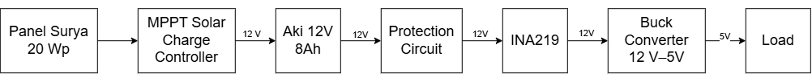
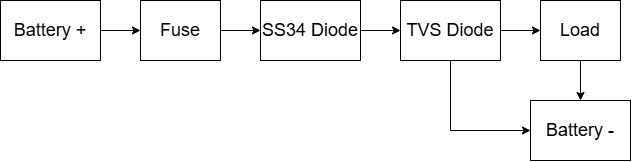

# 7 Power Management

## Current configuration

| Component or setting | Current information |
|---|---|
| Battery | 12 V 8 Ah, owner-confirmed |
| SCC rating | Maximum 10 A, owner-confirmed; exact model/type not yet recorded |
| Discharge setting | 10.7 V reported by the owner; verify the protected load path |
| Buck converter | MP1584, nominal 5 V / 3 A, owner-confirmed |
| Modem power switch | TS/MOSFET module, GPIO32 HIGH-on confirmed |
| Operation | Continuously active controller; no deep sleep or scheduled station shutdown |

## Power architecture

<div align="center">
  


</div>

<p align="center">Figure 7.1 Power architecture of the ESP32-based Miniweather Station.<p>

The figure is retained for the owner's later graphics revision and may show an earlier single-converter arrangement. The CAD reference has separate controller/sensor and modem branches using BC1/BC2. The owner-supplied 20 October PDF package contains corresponding footprints.

INA219 is on the protected input side of the converter branches in the CAD. BC1 supplies the controller/sensor rail through D3; BC2 supplies the modem through TS. Verify fitted modules, wiring, and any additional external connections before claiming complete load coverage.

The panel was previously documented as 20 Wp, but its label and the SCC model/type must be recorded for the final unit. Do not infer MPPT or PWM operation from the 10 A rating alone.

## Protection and distribution

<div align="center">
  


</div>

<p align="center">Figure 7.1 Protection circuit of the ESP32-based Miniweather Station.<p>

The reference design includes fuse protection, SS34 series diodes, a TVS, and decoupling/bulk capacitors. Check component ratings, polarity, and BOM metadata against the fitted board. A zero-DRC report does not establish surge, thermal, or field-reliability certification.

The 3V3 sensor rail is derived from the DevKit in the reference design. I2C header groups have different pad orders; see [Hardware Design](03.%20Hardware%20Design.md).

## Measurement point and units

The firmware reports `voltage = bus_voltage + shunt_voltage` in V and mean `getCurrent_mA()` in mA. These measurements are made at the installed INA219 point, downstream of upstream wiring/protection losses. They must not be presented as direct battery-terminal voltage without a measurement comparison.

The legacy MQTT key `power` now represents integrated **mWh per reporting minute**:

```text
energy_mWh = sum(power_mW * elapsed_ms) / 3600000
```

The code uses non-negative INA219 power readings and requires 60000 ms of valid coverage for a complete energy result. The corresponding CSV column is `energy_mWh`. For illustration, constant 3 W over 60 seconds is 50 mWh; this is an arithmetic example, not a measured device consumption.

The baseline does not compute battery state of charge or the losses upstream of the measurement point. The sum of minute energy values describes the observed load path, subject to valid data coverage.

## SCC discharge setting

The reported 10.7 V setting is a controller configuration value, not a firmware cutoff or a calibrated state-of-charge estimate. Record the SCC model and verify whether it disconnects the station's actual supply branch. A load wired directly to the battery may bypass the controller's LOAD disconnection.

## Modem supply verification

Measure the converter output and voltage directly at the USB modem connector while the modem starts and transmits. A nominal 5 V / 3 A rating does not replace loaded-voltage, transient, and temperature measurements. Keep the controller branch and modem branch identifiable during fault diagnosis.

The reference USB return is switched separately through the TS output net. Grounding another cable or instrument must not inadvertently bypass that switching path. Confirm the module's actual internal topology.

## Operation and future work

The ESP32 remains active for sensing and logging; modem power-cycling is a recovery action, not deep sleep of the whole station. Runtime and power claims require a recorded load profile, battery condition, charging conditions, and test duration.

Future work includes verified power profiling, converter/modem transient evaluation, battery estimation, and power scheduling. See [Future Development](10.%20Future%20Development.md).
