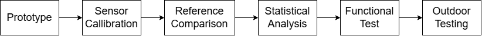
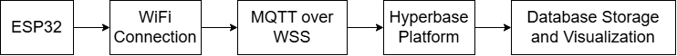
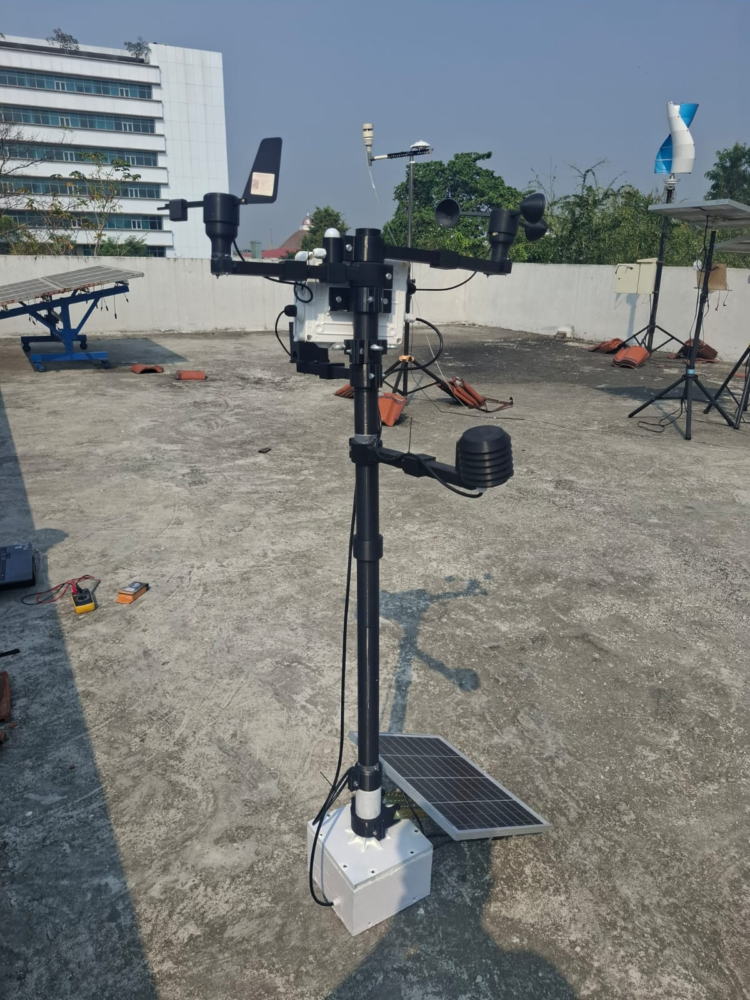

# 8 Calibration and Testing

## 8.1 Scope and evidence

This document retains the project's historical calibration dataset and distinguishes it from acceptance testing of the 10 November 2026 firmware and the current physical unit. A source review or successful compilation is not a new field-test result.

## 8.2 Calibration workflow

<div align="center">
  


</div>

<p align="center">Figure 8.1 Calibration workflow of the ESP32-based Miniweather Station.</p>

Record the sensor/unit identity, reference instrument, installation, raw dataset, firmware version, date, and method. Validate the inverse correction separately from reporting precision and aggregation. R2 denotes coefficient of determination; MAE/RMSE retain the parameter's units.

## 8.3 Methods

SCD40, BMP280, and BH1750 values are compared with appropriate reference measurements. Wind-vane alignment requires a recorded north reference. Pulse wind speed requires the actual sensor transfer function. Rainfall requires known tips/volume and collector geometry. JSN-SR04T requires installation distance, target geometry, and a valid measurement range. INA219 energy requires a known electrical load and duration.

For angular errors, use wrapped directional differences; ordinary percentage error near zero/north can be misleading.

## 8.4 Historical calibration performance

The following values are retained from the existing project report. They are not relabeled as new post-calibration or 10 November field results. The original dataset/date and exact tested configuration should be attached before using them as current acceptance evidence.

| Parameter | Reference Range | Mean Error | MAPE | MAE | RMSE |
|---|---|---|---|---|---|
| Temperature | 23.40–40.50 °C | −0.17 °C | 0.57% | 0.17 °C | 0.21 °C |
| Relative Humidity | 43.20–90.20 %RH | +1.18 %RH | 1.83% | 1.23 %RH | 1.56 %RH |
| CO₂ Concentration | 1510–3440 ppm | −119.50 ppm | 5.23% | 119.50 ppm | 122.61 ppm |
| Atmospheric Pressure | 996.10–996.80 hPa | −0.98 hPa | 0.10% | 0.98 hPa | 0.99 hPa |
| Altitude Estimation | 146.10–173.00 m | −5.40 m | 3.45% | 5.40 m | 5.42 m |
| Illuminance | 13–52,500 lux | +37.30 lux | 5.22% | 651.70 lux | 927.67 lux |
| Rainfall | 0.70–3.90 mm | +0.07 mm | 11.76% | 0.23 mm | 0.29 mm |
| Wind Speed | 0.61–7.01 m/s | −0.17 m/s | 7.27% | 0.23 m/s | 0.32 m/s |
| Wind Direction | 2–337° | −8.10° | 40.92%* | 10.70° | 12.78° |
| Water Level Distance | 0.00–24.30 cm | — | — | — | — |

The historical wind-direction MAPE is affected by angular wrap and near-zero reference values. Water-level entries without results remain unmeasured entries, not zero error.

## 8.5 Regression convention and implementation

The firmware explicitly interprets the reported regression as:

```text
sensor_reading = slope * reference_value + intercept
reference_estimate = (sensor_reading - intercept) / slope
```

The coefficients below are retained. Their application must follow the inverse relationship, not `corrected = slope * raw + intercept`. See [implemented calibration](../Firmware/calibration.md) for equations, clamping, and special cases.

| Parameter | Regression Equation | Slope | Intercept | R² |
|---|---|---|---|---|
| Temperature | y = 0.9976x − 0.0896 | 0.9976 | −0.0896 | 0.9995 |
| Relative Humidity | y = 1.0186x − 0.0879 | 1.0186 | −0.0879 | 0.9948 |
| CO₂ Concentration | y = 1.0058x − 134.3519 | 1.0058 | −134.3519 | 0.9987 |
| Atmospheric Pressure | y = 1.1781x − 178.3727 | 1.1781 | −178.3727 | 0.9053 |
| Altitude Estimation | y = 0.9641x + 0.2240 | 0.9641 | +0.2240 | 0.9960 |
| Illuminance | y = 1.0021x − 4.7057 | 1.0021 | −4.7057 | 0.9973 |
| Water Level Distance | y = −1.0257x + 88.00 | −1.0257 | +88.00 | 0.9867 |
| Rainfall | y = 1.1678x − 0.2808 | 1.1678 | −0.2808 | 0.9655 |
| Wind Speed | y = 0.8858x + 0.1804 | 0.8858 | +0.1804 | 0.9885 |
| Wind Direction | y = 0.9618x − 2.0622 | 0.9618 | −2.0622 | 0.9937 |

Rainfall applies its intercept once to the cumulative positive total, then uses differences for interval rainfall. Direction is wrapped and circularly averaged. The water-level equation uses the installation reference and a software clamp; the clamp is not proof of the sensor's physical range.

## 8.6 Acceptance tests for the baseline

| Test | Evidence required | Current reporting status |
|---|---|---|
| Aggregation and timing | One-second target, 60-second boundary, lag/invalid-data behavior | Record versioned results |
| Direction wrap | Inputs near 359 and 1 degrees produce a result near north | Record results |
| Rainfall | Known tip counts, initial/intercept behavior, restart total | Record results |
| Energy | Known load/duration comparison and invalid-coverage behavior | Record results |
| 30-minute network outage | Records retained within storage limits, live first, one backlog attempt per live ACK | Record results |
| Backlog/checkpoint interruption | No unexplained skipped records; duplicates handled by the platform | Record results |
| Missing/failed SD | Live path, eight-record RAM limit, overflow, and power-loss behavior | Record results |
| LED | CONNECT alone and backlog ACK alone cannot certify current live delivery; stale-loop snapshot expires | Record results |
| Dual WiFi | Authentication failure, AP selection, roaming, and broker failover | Record results |
| Modem recovery | Evidence classification, OFF/boot timing, cycle gap/budget, alternative-AP behavior | Record results |
| Clock and ingestion | UNSYNCED behavior, original timestamps, database mapping/deduplication | Record results |
| Power and assembly | Loaded supply, USB transient, component temperature, level conversion, harness | Record physical results |

The previous generic Passed checklist describes earlier prototype observations without sufficient version-specific evidence to certify these cases. Retain original test records; add dated results rather than assuming all new cases passed.

## 8.7 Communication verification

<div align="center">
  


</div>

<p align="center">Figure 8.2 Hyperbase dashboard during Miniweather Station testing.</p>

This retained dashboard image documents an earlier observation. Confirm broker PUBACK, application ingestion, database persistence, and dashboard rendering separately using message IDs and timestamps. PUBACK alone is not a database-write receipt.

## 8.8 Outdoor evaluation

<div align="center">
  


</div>

<p align="center">Figure 8.3 Outdoor deployment of the ESP32-based Miniweather Station.</p>

The project records describe DTNTF UGM rooftop evaluation. For each new run, record dates, location, firmware/CAD identity, weather/charging conditions, failures, maintenance, resets, and observed data continuity. The historical mostly-sunny description is not a current weather report or a qualification across seasons.

## 8.9 Further testing

Extend test duration and environmental coverage, compare with suitable references, quantify data loss/duplicates and recovery latency, and profile runtime heap and power. OTA acceptance belongs to a separate future integration test plan.
